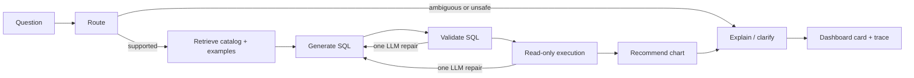

# Chat to Dashboard Lab

Turn a business question into a traceable SQL result, chart, and inspectable dashboard canvas. This is an independent educational reconstruction inspired by a résumé description of a chat-to-dashboard project at IpserLab. It uses new code and synthetic commerce data, and is not an official IpserLab repository or a reproduction of its historical performance results.

## Run locally

Python 3.11+ is required; the tested environment is Python 3.12. No API key is needed for the offline demo.

```bash
python3 -m venv .venv
source .venv/bin/activate
python -m pip install -c constraints.txt -e .
dashboard-lab serve
```

Open http://127.0.0.1:8765. A deterministic synthetic database is created on first run. Choose an example, run it, inspect the generated SQL and retrieved business definitions, then expand the execution trace. Result-table **Inspect** buttons drill into the actual order items behind revenue groups. Each question adds a card to the current page's canvas; refreshing clears the canvas.

```bash
dashboard-lab ask "Net revenue by month for 2025"
dashboard-lab ask "按月统计收入"
dashboard-lab ask "Revenue by category" --retrieval vector
dashboard-lab evaluate --output artifacts/evaluation.json
python -m unittest discover -s tests -v
```

## What is implemented

- A real compiled LangGraph workflow: route → retrieve → generate → guard → execute → visualize → summarize, with one bounded SQL-repair retry in LLM mode.
- A business catalog, metric dependency graph, and schema join graph. Graph expansion can be compared with a lexical-vector-only baseline.
- An opt-in semantic embedding provider with batched requests, cosine similarity, vector validation, and in-memory corpus caching.
- A library of 224 **synthetically generated** question/SQL retrieval examples. These are template variants, not 224 independently human-labeled tasks.
- A default deterministic SQL-template generator and an opt-in OpenAI-compatible LLM adapter.
- SQLGlot AST checks plus a read-only SQLite connection, engine authorizer, function/table allowlists, row cap, and execution budget.
- A small chart classifier trained on 600 synthetic structural feature examples, with a same-generator held-out evaluation and explicit rule fallbacks.
- A local dashboard with charts, SQL, result tables, contextual order-item drilldown, retrieved examples, and node timings.
- Independent reference-SQL fixtures, result comparison, response-routing metrics, retrieval ablation, unit/integration tests, and PR CI.

## Architecture



The orchestration is a stateful node workflow. It does not claim seven independent autonomous LLM agents: offline nodes use deterministic logic, while the optional LLM performs SQL generation and repair. This distinction is part of the learning exercise.

## Business definitions matter

The six tables are `customers`, `products`, `orders`, `order_items`, `refunds`, and `subscriptions`. Dates cover 2024–2025. Names and transactions are synthetic.

| Metric | Definition |
| --- | --- |
| Revenue | Sum of quantity × unit price × (1 − discount), completed orders only, before refunds |
| Gross sales | Sum of quantity × unit price, completed orders only |
| Net revenue | Revenue minus refunds, with each many-side aggregated by order before joining |
| Average order value | Revenue / distinct completed orders |
| Active customers | Distinct customers with a completed order in the reporting period |
| Refund rate | Distinct refunded completed orders / distinct completed orders |
| MRR | Active subscription value at month end; subscription end dates are exclusive |

Refunds are attributed to the original order month for this lab's net-revenue metric. This is not refund cash flow by refund date. Order-level refunds have no category allocation rule, so net revenue by category is clarified rather than fabricated.

Offline scope includes one metric, one grouping, all data or one calendar year, and top-product ranking. More complex or unsupported filters should return a clarification. It is a finite template demonstration, not general natural-language understanding.

## Optional LLM mode

Set `OPENAI_API_KEY`, `OPENAI_MODEL`, and optionally `OPENAI_BASE_URL` in your shell, then run:

```bash
dashboard-lab ask "Revenue by category for 2025" --mode llm
# or
dashboard-lab serve --mode llm
```

The adapter uses an OpenAI-compatible chat-completions JSON response. Model/endpoint compatibility must be checked for your provider. API usage may incur provider charges. A `.env` file is not automatically loaded. Never commit credentials.

Only the question, retrieved schema/definitions/examples, and any SQL repair context are sent to the configured model endpoint. Query result rows are summarized locally. No paid live-model run is claimed in the checked-in offline report; provider parsing/repair paths are tested with mocks.

### Optional semantic embeddings

Set `RETRIEVAL_EMBEDDINGS=remote`, `OPENAI_EMBEDDING_MODEL` to a model supported by your endpoint, and `OPENAI_API_KEY`. The embedding adapter uses the same `OPENAI_BASE_URL`. It sends schema/business catalog text, synthetic example questions, and the current question to that provider. Both graph and vector retrieval use the selected embedding backend.

This setting is independent of SQL generation: `--mode offline` still uses template SQL, but remote retrieval makes API calls and may incur charges. Default local retrieval makes no embedding calls. Each retriever embeds 238 catalog/example records in four batches, then embeds one question. The local server caches each retrieval mode's corpus in memory; subsequent questions in that mode require one question-embedding request. Restarting clears this cache. Invalid vectors and provider errors are surfaced without silently changing to lexical retrieval. Remote calls are covered by mocked tests; no live embedding-quality result is claimed.

The request format follows the [official embeddings endpoint](https://developers.openai.com/api/reference/resources/embeddings/methods/create).

## Evaluation and limits

See [the measured report](docs/EVALUATION.md) and [the learning labs](docs/LABS.zh-CN.md). The JSON report contains individual cases, generated/reference SQL, actual/expected rows, denominators, retrieval outputs, and limitations.

Offline SQL is generated from templates independently of retrieval. Therefore, improved table retrieval **cannot establish an end-to-end answer gain** in this mode. Graph retrieval here means expansion over an explicit schema/business graph; it is not Microsoft's community-summary GraphRAG implementation. Default local vectors are hashed lexical features. The optional remote backend supplies pretrained semantic embeddings, whose actual quality must be evaluated separately.

Fixture questions are separate from retrieval-example strings, but they share schema and template families. During development they are regression fixtures, not a secret or independently collected benchmark. A real quality study requires frozen external questions, human-reviewed answers, semantic embeddings, live-model trials, repeated seeds, and cost/latency analysis.

Historical résumé figures (93% execution success, routing F1 0.91, schema linking 74%→89%, 78% zero-correction, and time-to-insight gains) are **not** recreated by the synthetic tests. The project does not claim user-study results or original company ownership of this code.

## Files to read

| File | Responsibility |
| --- | --- |
| `src/dashboard_agent/data.py` | Seeded synthetic commerce data and generated assets |
| `src/dashboard_agent/engine.py` | Graph orchestration, routing, SQL templates, repair |
| `src/dashboard_agent/retrieval.py` | Lexical retrieval, metric and schema graph traversal |
| `src/dashboard_agent/sql_safety.py` | SQL policy and bounded read-only execution |
| `src/dashboard_agent/providers.py` | Optional model adapter |
| `src/dashboard_agent/chart_model.py` | Synthetic chart model and recommendation |
| `src/dashboard_agent/evaluation.py` | Reference queries and metrics |
| `src/dashboard_agent/server.py` | Loopback-only UI and fixed order-item drilldown |

## References

- [LangGraph graph API](https://docs.langchain.com/oss/python/langgraph/graph-api)
- [SQLGlot documentation](https://sqlglot.com/)
- [Python sqlite3 authorizers and progress handlers](https://docs.python.org/3/library/sqlite3.html)

The web server is a local teaching tool without authentication or tenant isolation. Keep its loopback binding; production deployment requires a separate security and access-control design.
